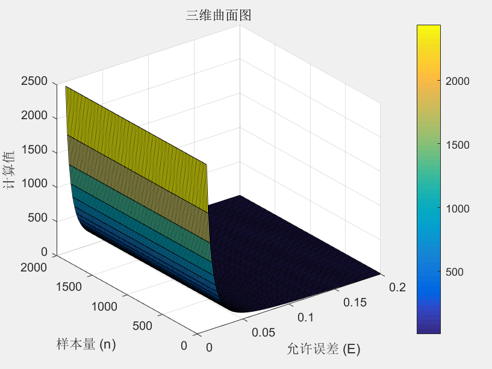
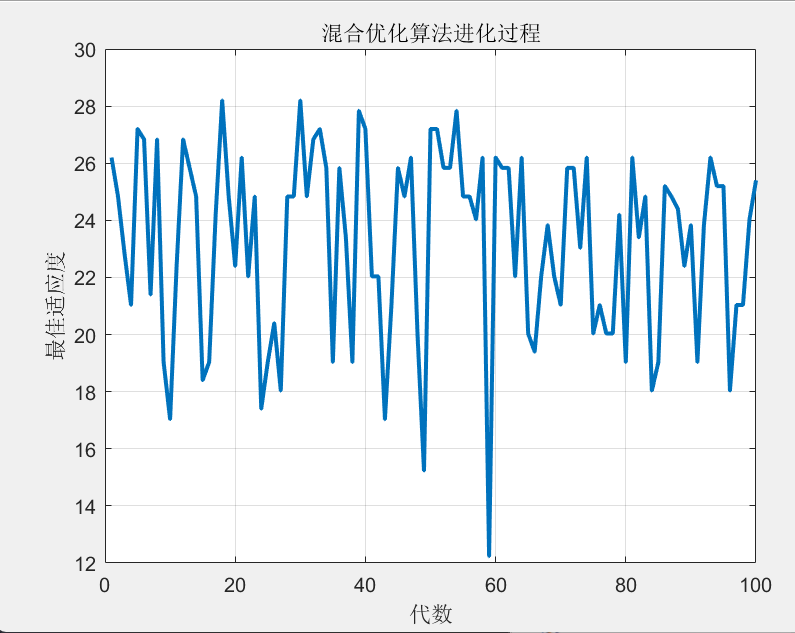

# 2024 全国大学生数学建模竞赛 B 题：生产过程中的决策

> 新疆赛区**二等奖**作品：围绕电子产品“抽样检测 → 拆解再制造 → 多工序混合整数规划（MILP）+ 马尔可夫决策过程（MDP）+ GA/PSO 混合寻优 → 分布鲁棒优化（DRO）”全链路建模与求解。

| 问题 | 模型与算法 | 对应脚本 / 结果图 |
|---|---|---|
| **问题一** | 二项分布单侧抽样检测、置信度与样本量权衡曲面分析 | [`code/moxing1.m`](code/moxing1.m) · [`q1_sampling_surface.png`](figures/q1_sampling_surface.png) |
| **问题二** | 整数线性规划（检测 / 拆解决策变量与成本分解） | [`code/moxing2.m`](code/moxing2.m) · [`q2_cost_comparison.png`](figures/q2_cost_comparison.png) |
| **问题三** | 多工序多零配件：MILP + Bellman 最优拆解 MDP + GA/PSO 混合进化 | [`code/moxing3.m`](code/moxing3.m) · [`q3_hybrid_ga_pso_evolution.png`](figures/q3_hybrid_ga_pso_evolution.png) |
| **问题四** | 抽样次品率不确定性下的分布鲁棒优化（DRO）+ 蒙特卡洛模拟 | [`code/moxing4.m`](code/moxing4.m) · [`q4_dro_flowchart.png`](figures/q4_dro_flowchart.png) |

| 问题一：抽样容许误差与样本量曲面 | 问题三：GA+PSO 混合进化收敛曲线 |
|---|---|
|  |  |

> 赛题原始商业/题目附件及完整参赛论文全文未随仓库分发，已保留 4 个核心 MATLAB 求解脚本与 9 张关键可视化结果图。
