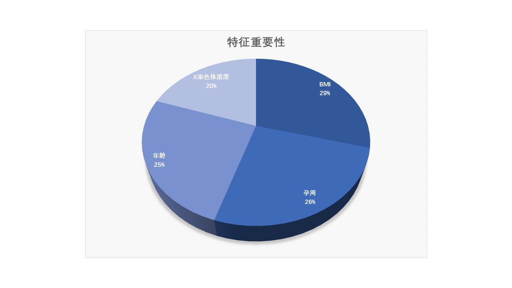
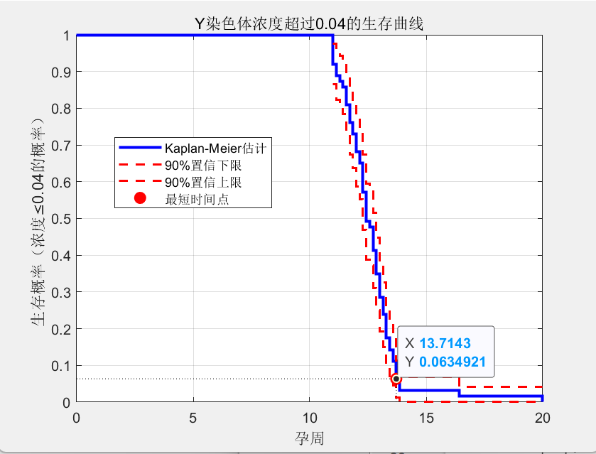

# 2025 全国大学生数学建模竞赛 C 题：NIPT 的时点选择与胎儿异常判定

> 新疆赛区**二等奖**作品：围绕无创产前检测（NIPT）男胎 Y 染色体浓度随孕周与孕妇 BMI 的演化规律及染色体非整倍体风险判定，形成 **“参数回归失败排查 → 聚类与生存分析最优时点划分 → XGBoost 回归/贝叶斯优化 → SMOTE + XGBoost 异常分类”** 四步完整代码链（MATLAB + Python）。

## 代码清单（4 MATLAB + 3 Python）

| 问题 | 语言 | 脚本 | 作用 |
|---|---|---|---|
| **问题一** | MATLAB | [`code/q1_regression_exploration.m`](code/q1_regression_exploration.m) | 相关性检验与多项式/双对数等常规回归探索（发现 `R² < 0.1` 的转折起点） |
| **问题二** | MATLAB | [`code/q2_bmi_clustering.m`](code/q2_bmi_clustering.m) / [`q2_fit_group1.m`](code/q2_fit_group1.m) / [`q2_fit_group2.m`](code/q2_fit_group2.m) | BMI 三区间划分与生存/拟合曲线 |
| **问题三** | Python | [`code/q3_spearman_analysis.py`](code/q3_spearman_analysis.py) | 孕周、BMI、Y 染色体 Z 值、GC 含量等 Spearman 相关性热力图分析 |
| **问题三** | Python | [`code/q3_xgboost_y_prediction.py`](code/q3_xgboost_y_prediction.py) | 基于 **XGBoost** 的 Y 染色体浓度回归预测与评估（`R² = 0.794` 链路核心脚本） |
| **问题四** | MATLAB + Python | [`code/q4_chromosome_aneuploidy_classification.py`](code/q4_chromosome_aneuploidy_classification.py)、[`q4_xgboost_classify_1.m`](code/q4_xgboost_classify_1.m)、[`q4_xgboost_classify_2.m`](code/q4_xgboost_classify_2.m) | **SMOTE 过采样 + XGBoost** 胎儿异常二分类（**AUC = 0.952**）与特征重要性导出 |

> **说明**：原始医疗检测 Excel 数据涉及隐私，未随仓库分发；`q3_xgboost_y_prediction.py` 与 `q4_chromosome_aneuploidy_classification.py` 内置了独立可运行的模拟数据兜底逻辑。

| 特征重要性分析（问题三） | BMI 分组拟合趋势示例 |
|---|---|
|  |  |
