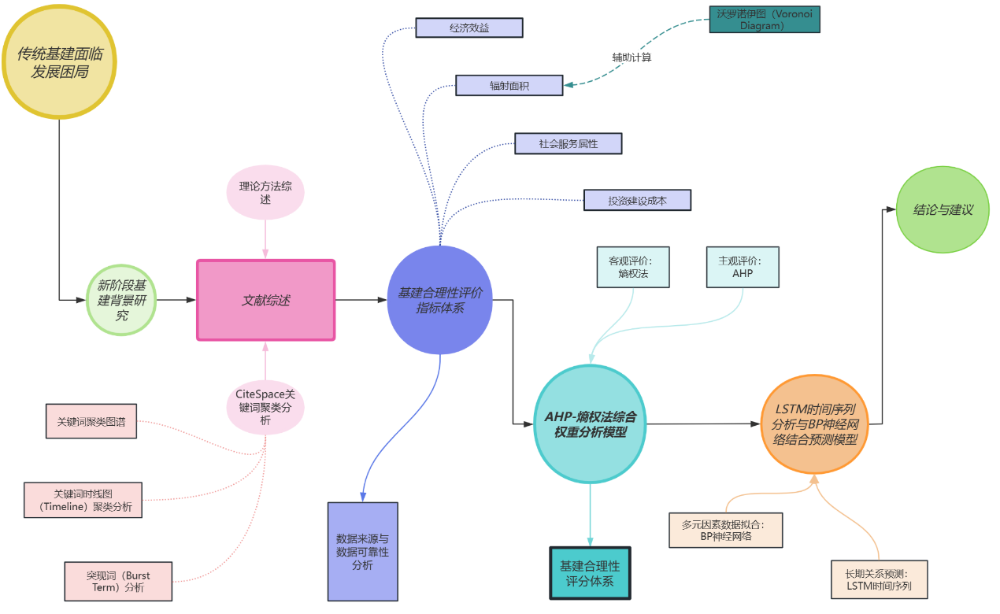
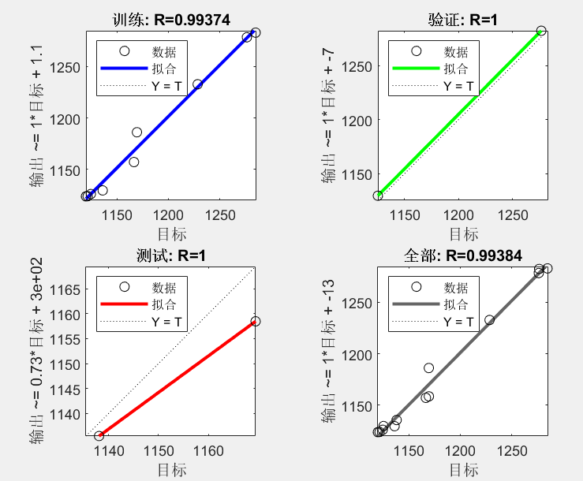
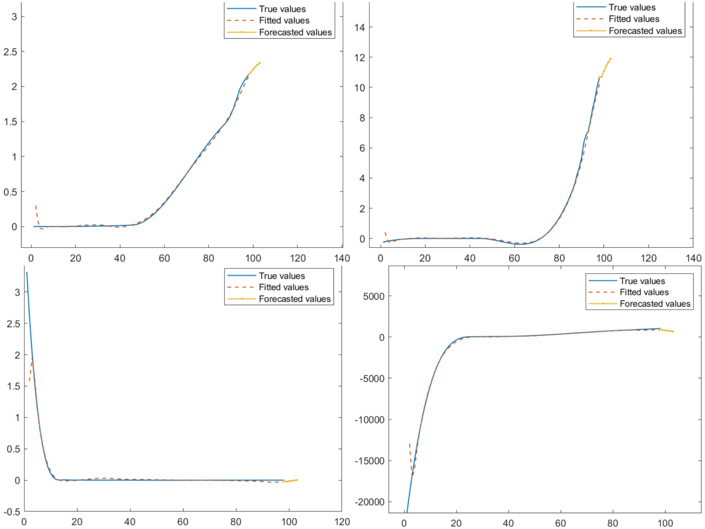

# 2024 全国大学生统计建模大赛：新基建浪潮下中国传统基建的破局分析

> 第十届全国大学生统计建模大赛新疆赛区**一等奖**作品：以京沪/北京高铁站及区域交通网络为例，基于 **AHP-熵权法主客观综合赋权**构建“经济效益—辐射面积（Voronoi）—社会服务属性—投资建设成本”四维评价体系，并联合 **BP 神经网络与 LSTM 时间序列**对长期客运与基础设施适应性进行拟合与预测。

## 模型框架与实验结果

| 环节 | 核心方法 | 产出成果 |
|---|---|---|
| **空间辐射与评价** | Voronoi 图辅助计算辐射范围 + **AHP-熵权法综合权重** | 22 个高铁站多维合理性评分 |
| **多元非线性拟合** | 多层 **BP 神经网络**回归拟合 | 训练/全部相关性 **R = 0.9938**（[`bp_regression_fit.png`](figures/bp_regression_fit.png)） |
| **长期时序预测** | 100 轮迭代 **LSTM 序列预测**模型 | 训练收敛曲线与多指标前瞻预测 |

| BP 神经网络回归拟合（R = 0.99384） | LSTM 序列多指标拟合与预测 |
|---|---|
|  |  |

> **归档边界说明**：本竞赛提交包以 RESSET 经济数据集与 MATLAB Deep Learning Toolbox / AHP 表格计算输出为主，未保留独立整理的脚本源码包；本目录归档论文方法路线图与核心拟合/预测可视化结果（原始 RESSET 数据不予公开）。
