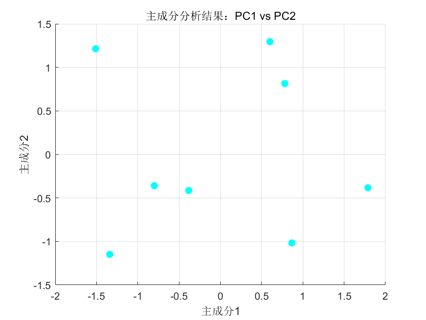
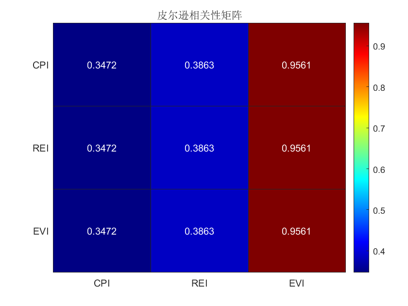
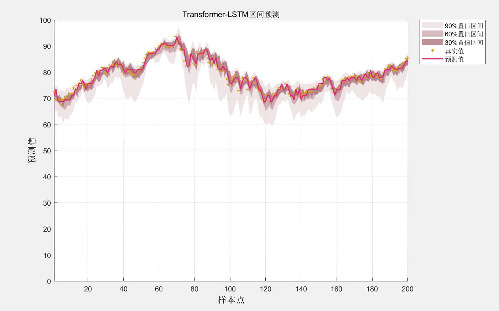

# 2025 全国大学生统计建模大赛：混合能源市场油价预测

> 新疆赛区**一等奖**作品：构建融汇碳价（CP）、可再生能源（RE）与电动车替代（EV）的 **ETOPI 能源转型指标**，并采用 **三阶段 VAR 模型** + **ARIMAX 结构断点动态集成** + **Transformer-LSTM-XGBoost 贝叶斯优化混合模型（含分位数回归区间预测）**。

## 脚本组成与依赖边界说明

| 阶段 | 文件 | 说明与可独立运行边界 |
|---|---|---|
| **指标构造** | `code/carbonprice.m`, `zhengce.m`, `zhixinglidu.m`, `kezaisheng.m`, `fadianliang.m`, `zhuangjironglian.m`, `chengbenxiajiang.m` | PCA、Pearson 相关检验与指标加权建模脚本 |
| **机制切换** | [`code/arimax_regime_ensemble.m`](code/arimax_regime_ensemble.m) | 内置 2010–2024 宏微观样本表，演示 Chow 结构断点检测 + 两阶段 ARIMAX 动态权重集成（可独立运行） |
| **阶段模型** | `code/model2_*.m` | 能源转型三阶段划分、VAR 时序估计与阶段预测集成 |
| **混合深度学习** | [`code/model3_transformer_lstm_xgb.m`](code/model3_transformer_lstm_xgb.m) | **客观依赖说明**：该脚本依赖外部导出配置文件 `MT_24_Apr_2025_02_30_09.mat` 及 Deep Learning/Bayesian 工具箱自定义封装函数，因此**不可脱离对应 `.mat` 与商业数据源单独即点即跑** |

| 碳价指标主成分分析 | 变量 Pearson 相关性 | 分位数回归区间预测 |
|---|---|---|
|  |  |  |
